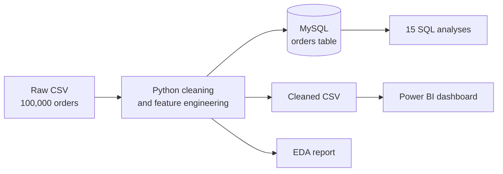

# Online Food Delivery Analysis: Data-Driven Business Insights

An end-to-end analytics project on 100,000 food delivery orders: cleaning and feature engineering in **Python**, storage and analysis in **MySQL**, and an interactive **Power BI** dashboard that tracks revenue, delivery performance and cancellations by city.


---

## Project overview

Online food delivery platforms need to understand how customers order, where delivery slows down, which restaurants perform well, and why orders get cancelled. This project answers those questions with a full analytics pipeline:

- **Clean** a raw order dataset and engineer analysis-ready features.
- **Store** the cleaned data in a MySQL database.
- **Query** the data with 15 SQL analyses covering customers, revenue, delivery, restaurants and operations.
- **Explore** the data in an EDA report with charts and plain-language insights.
- **Visualise** the headline KPIs in a Power BI dashboard.

## Dataset

| | |
|---|---|
| **Raw size** | 100,000 orders, 25 columns |
| **Cleaned size** | 71,541 orders |
| **Period** | 1 Jan 2024 to 30 Dec 2024 |
| **Coverage** | 5 cities (Bangalore, Chennai, Delhi, Hyderabad, Mumbai) and 5 cuisines (Indian, Chinese, Mexican, Italian, Arabian) |

**Main fields:** customer (ID, age, gender), location (city, area), restaurant (ID, name, cuisine), order (date, value, discount, final amount, payment mode, status, cancellation reason), delivery (time, distance, partner), ratings (restaurant and delivery), and profit margin.

## Workflow



## Data cleaning and feature engineering

All steps are in `notebooks/01_data_cleaning.ipynb`.

| Step | What was done |
|---|---|
| Dates | Parsed `Order_Date` and removed 1,014 rows (1%) with no date |
| Categorical gaps | City, Area, Cuisine, Payment Mode and Gender filled with the most frequent value |
| Numeric gaps | Order Value, Distance, Discount and Delivery Rating filled with the median |
| Delivery time | Missing values filled with the median; extreme values capped at the 95th percentile (282 min) |
| Amounts | Discount capped at the order value; `Final_Amount` recalculated as `Order_Value - Discount_Applied` |
| Customer age | Filled with the median age of the customer's city |
| Cancellation reason | `Not Applicable` for delivered orders; remaining blanks set to `Not Specified` |
| Peak hour | Converted to `Peak` / `Off-Peak`; blanks set to `Unknown` |
| Ratings | Restaurant rating capped at 5 |
| Invalid rows | Removed rows with a negative `Profit_Margin` |
| Standardisation | Trimmed whitespace and applied consistent title case to text columns |
| Dropped column | `Order_Time` |

**Engineered features**

| Feature | Rule |
|---|---|
| `Delivery_Category` | `Quick` (60 min or less), `Normal` (61 to 120 min), `Delayed` (over 120 min) |
| `Customer_Segment` | `Young` (under 30), `Adult` (30 to 44), `Senior` (45 and over) |

The cleaned data is written to a MySQL database (`online_food_delivery_db`, table `orders`) using SQLAlchemy and PyMySQL.

## SQL analysis

All 15 queries are in `notebooks/02_sql_analysis.ipynb`. Revenue, delivery time and rating metrics use **delivered** orders only.

| Area | Analysis |
|---|---|
| **Customers and orders** | Top-spending customers, age group vs order value, weekday vs weekend demand |
| **Revenue and profit** | Monthly revenue trend, discount impact on profit, revenue by city, revenue by cuisine |
| **Delivery performance** | Average delivery time by city, distance vs delay (quartiles using `NTILE`), delivery rating vs delivery time |
| **Restaurants** | Top-rated restaurants, cancellation rate by restaurant, cuisine scorecard |
| **Operations** | Peak-hour demand, payment mode preferences (`RANK`/window functions), cancellation reasons |

## Key insights

**Demand and revenue**
- Total revenue from delivered orders is about **Rs 103.2 million**, with an average order value of about **Rs 1,700**.
- Revenue is steady through the year, between **Rs 8.3M** (February) and **Rs 8.9M** (July) per month.
- **Hyderabad** and **Indian cuisine** each account for about **34%** of orders and about **Rs 34.8M** of revenue, roughly double any other city or cuisine.
- Weekdays and weekends are equally busy: **195.6** vs **196.9** orders per day.
- The top customer spent **Rs 41,692** across 17 orders. The top 10 customers sit between Rs 32.7K and Rs 41.7K, so there is no single dominant customer.
- Age group makes no difference to order value (about Rs 1,775 to Rs 1,786 across all three groups).

**Delivery**
- Deliveries average **125 minutes**. Only about 27% arrive within an hour, and about 33% take longer than two hours.
- **Distance does not drive delays.** Average delivery time is 124 to 125 minutes in every distance quartile, and the delayed share stays near 33%. Delivery time is also flat across cities (123 to 125 min).
- Customers rate restaurants far higher (**4.20**) than delivery (**2.98**), so delivery is the weaker part of the experience.

**Cancellations**
- About **15%** of orders are cancelled, and the rate is almost identical in every city (15.0% to 15.3%).
- **40%** of cancellations have no recorded reason. The recorded reasons (customer cancelled, late delivery, restaurant issue) each account for about 20%.
- A few restaurants cancel noticeably more than average, for example Restaurant_202 at about 24%.

**Payments, profit and peak hours**
- **Card** is the most used payment mode (40%); wallet, UPI and cash on delivery are about 20% each.
- Average profit margin is about **25%** and stays at that level whether or not a discount is applied.
- Peak and off-peak orders are evenly split (about 33% each), with another third flagged `Unknown`.

**Suggested actions**
1. Make cancellation reasons mandatory at checkout, since 40% are currently unrecorded.
2. Look beyond distance for the cause of slow deliveries, such as restaurant preparation time and rider allocation.
3. Prioritise the delivery experience, which has the lowest rating.
4. Review restaurants with cancellation rates well above the 15% average.

The full set of charts and plain-language insights is in the [EDA report](reports/EDA_Report_Online_Food_Delivery.docx).

## Dashboard

Built in **Power BI** from the cleaned dataset (`online_food_delivery` table).

**Layout**
- **Left panel:** city buttons that filter the whole page, a city icon that changes with the selection, and two rings for **Total Orders** and **Cancellation Rate**.
- **Top row:** KPI cards for Total Revenue, Average Order Value, Profit Margin %, Average Delivery Rating and Average Delivery Time.
- **Middle:** Monthly Orders (line chart) and Monthly Revenue (column chart).
- **Right side:** Revenue by Cuisine (bar chart), Top-Rated Cuisine and Restaurant Rating cards.

**KPI definitions**

| KPI | Definition |
|---|---|
| Total Orders | Count of all orders |
| Total Revenue | Sum of `Final_Amount` for delivered orders |
| Average Order Value | Total revenue divided by delivered orders |
| Average Delivery Time | Mean `Delivery_Time_Min` for delivered orders |
| Cancellation Rate | Cancelled orders divided by all orders |
| Average Delivery Rating | Mean `Delivery_Rating` for delivered orders |
| Profit Margin % | Mean `Profit_Margin` |

<details>
<summary>DAX measures</summary>

```DAX
Total Orders = COUNTROWS(online_food_delivery)

Total Revenue =
CALCULATE(SUM(online_food_delivery[Final_Amount]),
          online_food_delivery[Order_Status] = "Delivered")

Avg Order Value =
DIVIDE([Total Revenue],
       CALCULATE(COUNTROWS(online_food_delivery),
                 online_food_delivery[Order_Status] = "Delivered"))

Avg Delivery Time =
CALCULATE(AVERAGE(online_food_delivery[Delivery_Time_Min]),
          online_food_delivery[Order_Status] = "Delivered")

Cancellation Rate =
DIVIDE(CALCULATE(COUNTROWS(online_food_delivery),
                 online_food_delivery[Order_Status] = "Cancelled"),
       CALCULATE(COUNTROWS(online_food_delivery),
                 ALL(online_food_delivery[Order_Status])))

Avg Delivery Rating =
CALCULATE(AVERAGE(online_food_delivery[Delivery_Rating]),
          online_food_delivery[Order_Status] = "Delivered")

Profit Margin % = AVERAGE(online_food_delivery[Profit_Margin])
```

</details>

## Repository structure

```
online-food-delivery-analysis/
├── README.md
├── requirements.txt
├── .gitignore
├── data/
│   ├── raw/                      # original dataset (not tracked if large)
│   └── cleaned_orders.csv        # cleaned data used by Power BI
├── notebooks/
│   ├── 01_data_cleaning.ipynb    # cleaning, feature engineering, MySQL load
│   ├── 02_sql_analysis.ipynb     # 15 analytical SQL queries
│   └── 03_eda_report.ipynb       # EDA charts and insights
├── reports/
│   └── EDA_Report_Online_Food_Delivery.docx
├── dashboard/
│   └── online_food_delivery.pbix
└── images/
    └── dashboard.png
```

## How to run

**1. Set up the environment**

```bash
git clone https://github.com/<your-username>/online-food-delivery-analysis.git
cd online-food-delivery-analysis
python -m venv .venv
source .venv/bin/activate        # Windows: .venv\Scripts\activate
pip install -r requirements.txt
```

**2. Set your MySQL credentials** (never hard-code the password in a notebook)

```bash
export MYSQL_USER=root
export MYSQL_PASSWORD=your_password      # Windows PowerShell: $env:MYSQL_PASSWORD="your_password"
```

**3. Run the notebooks in order**

1. `01_data_cleaning.ipynb` cleans the data and creates the `orders` table in `online_food_delivery_db`.
2. `02_sql_analysis.ipynb` runs the 15 SQL analyses (needs **MySQL 8 or later** for window functions).
3. `03_eda_report.ipynb` regenerates the EDA charts into `eda_figures/`.

**4. Open the dashboard**

Open `dashboard/online_food_delivery.pbix` in Power BI Desktop. If the data source path differs on your machine, update it under Home, Transform data, Data source settings.

## Author

**[Makesh P]**
[LinkedIn](https://www.linkedin.com/in/makesh-p-54759b2a9?utm_source=share_via&utm_content=profile&utm_medium=member_android) | [GitHub](https://github.com/Makesh-P)
