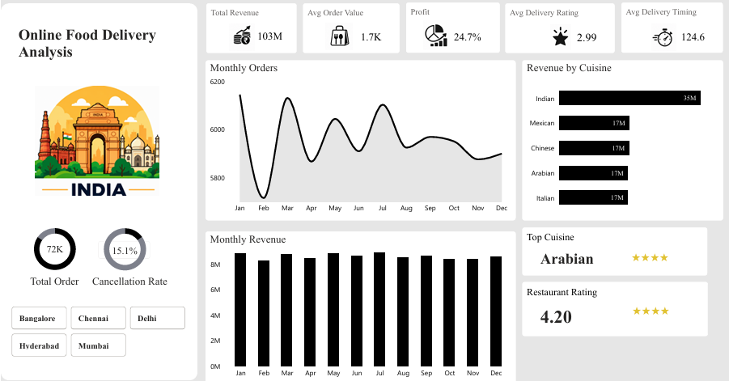
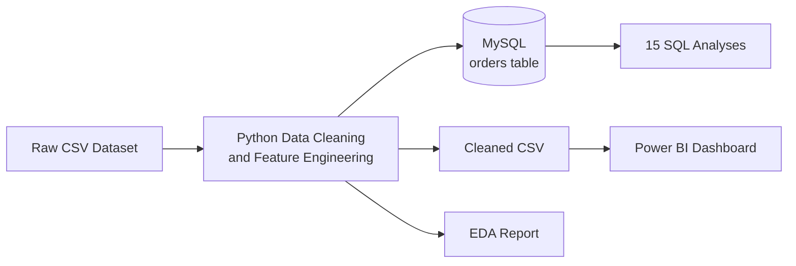

# Online Food Delivery Analysis

An end-to-end data analytics project that turns online food delivery data into business insights using Python, MySQL, SQL and Power BI.

## Overview

This project explores order volume, revenue, customer and restaurant ratings, delivery times, cancellations, discounts, cities and cuisines.

## Dashboard Preview




## Features

- Clean and prepare data using Pandas and NumPy
- Explore trends and relationships through EDA
- Store cleaned data in MySQL
- Answer business questions using SQL
- Visualise KPIs and monthly trends in Power BI
- Summarise findings and business recommendations

## Tech Stack

| Area | Tools |
|---|---|
| Programming | Python, SQL, DAX |
| Data analysis | Pandas, NumPy, Matplotlib, Seaborn |
| Database | MySQL, SQLAlchemy, PyMySQL |
| Dashboard | Microsoft Power BI |
| Tools |VS Code, MySQL Workbench |

## Project Structure

```text
Online-Food-Delivery-Analysis/
├── Data_Cleaning.py
├── EDA.ipynb
├── SQL.ipynb
├── Online_Food_Delivery_Dashboard.pbix
├── ONLINE_FOOD_DELIVERY_ANALYSIS.csv
├── screenshots/
│   └── dashboard_overview.png
└── README.md
```

## Getting Started

### Prerequisites

- Python 3.10+
- MySQL Server
- Power BI Desktop

### Installation

```bash
git clone https://github.com/Makesh-P/Online-Food-Delivery-Analysis.git
cd Online-Food-Delivery-Analysis
python -m pip install -r requirements.txt
```

### Run the project

1. Place `ONLINE_FOOD_DELIVERY_ANALYSIS.csv` in the project folder, or update its path in `Data_Cleaning.py`.
2. Configure your local MySQL credentials in the script. Do not commit passwords to GitHub.
3. Run the cleaning script to clean the data and load it into `online_food_delivery_db`, table `orders`:

   ```bash
   python Data_Cleaning.py
   ```

4. Open `EDA.ipynb` to explore the data and `SQL.ipynb` to run the business queries.
5. Open `Online_Food_Delivery_Dashboard.pbix` in Power BI Desktop and configure the data source if prompted.

## Workflow


## Dataset

| | |
|---|---|
| **Raw size** | 100,000 orders, 25 columns |
| **Cleaned size** | 71,541 orders |
| **Period** | 1 Jan 2024 to 30 Dec 2024 |
| **Coverage** | 5 cities (Bangalore, Chennai, Delhi, Hyderabad, Mumbai) and 5 cuisines (Indian, Chinese, Mexican, Italian, Arabian) |

## Data Cleaning & Feature Engineering

The cleaning process handles missing values, converts dates, standardises categories, caps high delivery times, limits discounts to order values, removes rows with missing order dates and negative profit margins, and creates these derived fields:

| Column | Definition |
|---|---|
| `Final_Amount` | Order value minus discount |
| `Delivery_Category` | Quick (≤60 min), Normal (61–120 min), or Delayed (>120 min) |
| `Customer_Segment` | Young (<30), Adult (30–44), or Senior (45+) |
| `Peak_Hour` | Peak, Off-Peak, or Unknown |

## Exploratory Data Analysis & SQL

EDA covers order value and delivery-time distributions, city and cuisine patterns, weekend versus weekday demand, distance versus delivery delay, cancellation reasons and correlations.

SQL queries analyse revenue, orders, customer behaviour, restaurant performance, delivery efficiency, cancellations, discounts and ratings.

## Dashboard

The Power BI dashboard includes KPI cards for total revenue, average order value, profit margin, average delivery rating and average delivery time, along with monthly trends and city filters.

## Key Findings

- About 40% of cancelled orders have no cancellation reason recorded.
- Around one-third of deliveries take more than two hours in the examined city and distance groups.
- The highest-cancellation restaurants show rates of about 21.9%–23.7%, compared with an overall rate of 15.1%.
- Hyderabad and Indian cuisine each contribute roughly one-third of revenue.
- About 83% of orders have a discount applied, so discount effectiveness is worth testing.
- Delivery times are broadly similar across distance ranges, suggesting distance alone may not explain delays.

## Recommendations

- Require a cancellation reason for cancelled orders.
- Investigate preparation and rider-allocation processes for delayed orders.
- Review restaurants with high cancellation rates.
- Test loyalty offers and measure their impact.
- Evaluate whether discounts increase orders and repeat purchases enough to justify their cost.

## Author

**Makesh P**

[LinkedIn](https://www.linkedin.com/in/makesh-p-54759b2a9) | [GitHub](https://github.com/Makesh-P)
